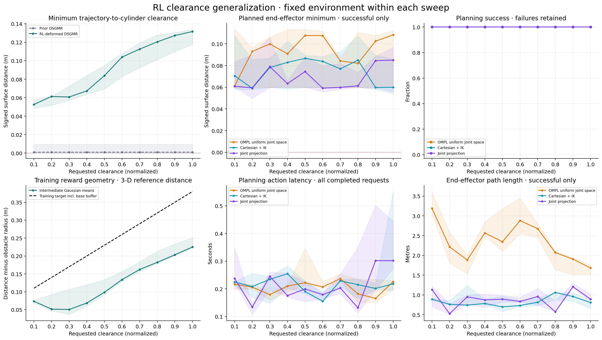
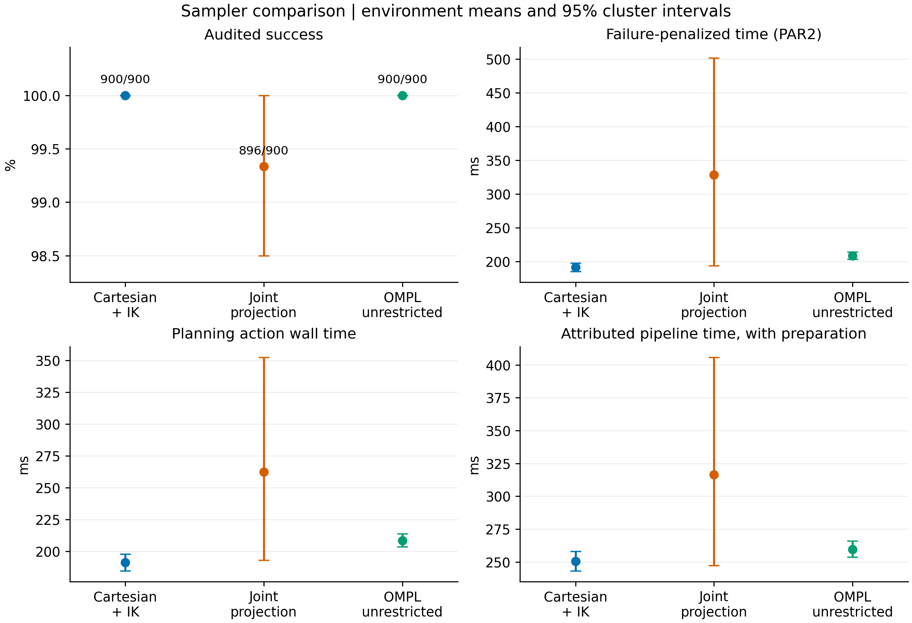
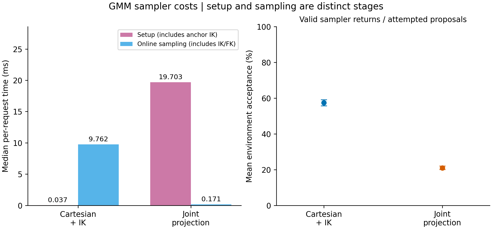
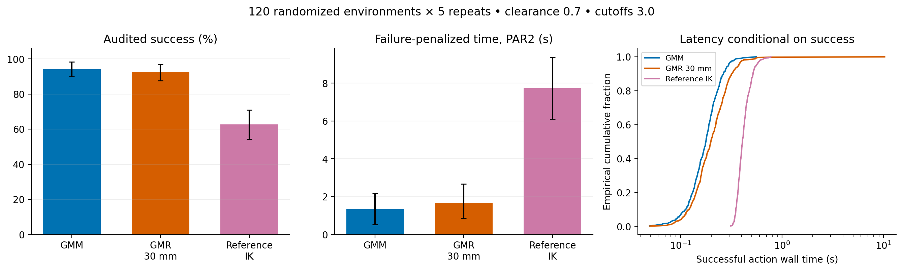
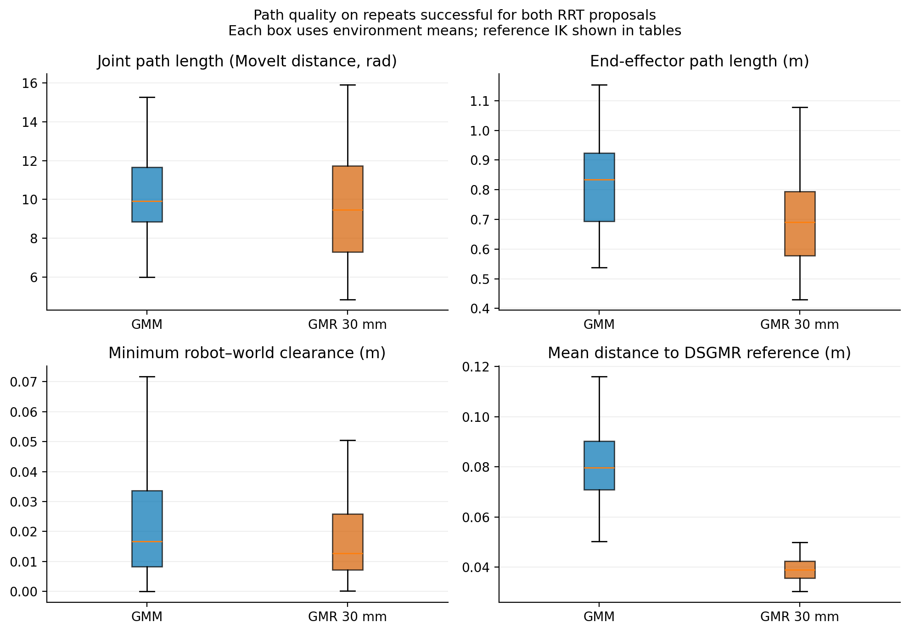

# Three case studies with the benchmark sampling framework

These results replace the earlier box-corridor results for describing the current framework. They contain **4,740 measured requests**: 150 clearance-sweep requests, 2,700 mapping-comparison requests, and 1,890 proposal-comparison requests. Nine additional warmups in the proposal study are excluded. Earlier observations and Hybrid outcomes are not pooled into these analyses.

The strongest findings concern path geometry and computational tradeoffs. Joint projection produces shorter paths than Cartesian IK, without a demonstrated reliability or latency advantage. GMR produces paths closer to the reference than GMM, while GMM has lower failure-penalized planning time and greater robot–world clearance. The clearance sweep shows a responsive deformation policy, but does **not** establish attainment of its requested clearance target.

## Common framework

All comparisons use RRTConnect, requested range **0.0** (OMPL automatic range), one planning attempt, a **10 s** planning budget, and unsimplified geometric paths. The GMM hard region is the **union of covariance ellipsoids at cutoff 3.0**. GMR uses 30 mm isotropic proposal standard deviation, radial cutoff 3.0, and a 90 mm tube around the post-RL reference connected to the actual FK endpoints. Uniform mixtures and default-sampler fallback are disabled. Hybrid is absent from the active comparisons.

The ellipsoid predicate applies to planner states and interpolated edges, as well as sampler targets. Edge resolution is 0.00005 of state-space extent; a separate returned-path audit checks joint bounds, collision and support at joint-vector Euclidean spacing no greater than 0.005 rad. No successful returned path failed this audit. All source-purity checks passed, and projected sampling made zero online IK calls. Returned joint endpoints satisfy the requested 0.001 rad tolerance; the largest observed error was below 0.001 rad.

[FRAMEWORK_ALIGNMENT.md](../../FRAMEWORK_ALIGNMENT.md) records the implementation changes and differences from the EV execution benchmark. The historical scenes, model, RL checkpoint, joint endpoints and trial orders were retained. Reproduction/deformation were remeasured and, for the mapping/proposal replays, checked against the saved models and raw references. This rerun does not create new independent environments or a new confirmatory dataset.

## Case 1 — RL clearance response

The five original environments and joint endpoint pairs were held fixed while the normalized clearance input swept **0.1–1.0 in steps of 0.1**. All three planning configurations succeeded at all 50 settings, giving **150/150 audited successes**.

The deformed reference's minimum cylinder clearance was nondecreasing in **44/45** adjacent-level comparisons, allowing 2 mm variation. Planned EE clearance was nondecreasing in **29/45** comparisons for each GMM sampler. These are descriptive paired results across five environments. They show that stronger clearance input usually moves the reference farther from the obstacle, while planning within the permitted region can produce a different trend.

**None of the 50 unique deformations met the strict training-clearance criterion.** The three sampler rows at each setting share one deformation and must not be counted as three policy evaluations. Increased reference clearance and collision-free planning therefore do not imply that the requested reward-distance target was achieved. The normalized clearance input is not a distance in metres; training-reference distance, EE-to-cylinder-surface distance and full-robot clearance are different quantities.

Unrestricted OMPL does not receive the clearance input. Its apparent clearance trend reflects independent planning variation. The Case 1 raw `end_to_end_wall_s` field includes the shared deformation call for every method because this is a deformation sweep; use the mapping comparison below for pipeline-latency claims about an OMPL baseline that needs no learned model.

[Measurement notes](clearance/summary.md) · [Paired environment responses](clearance/paired_environment_response.pdf) · [Trial metrics](clearance/trials.csv)

## Case 2 — Cartesian IK, joint projection and unrestricted OMPL

This comparison retains the original-height scene and clearance inputs **0.2/0.8**. The original primary cohort has 60 environments and ten repeats per method; the separate confirmation cohort has 60 environments and five repeats. All 2,700 prescribed requests are retained.

| Method | Audited successes | Mean action time (ms) | Mean attributed pipeline (ms) | Mean joint travel (rad) | Mean EE length (m) |
|---|---:|---:|---:|---:|---:|
| Cartesian IK | 900/900 | 191.18 | 250.56 | 10.408 | 0.811 |
| Joint projection | 896/900 | 262.21 | 316.53 | 9.166 | 0.751 |
| Unrestricted OMPL | 900/900 | 208.47 | 259.57 | 13.967 | 2.239 |

Means weight the **120 environments equally**, including both cohorts. Path means use successful requests within each environment; latency means include failures. Raw counts and environment-weighted success estimates differ when repeat counts differ: projection's pooled rate is 99.56%, whereas its equally weighted environment estimate is 99.33%. Joint travel here is the MoveIt summed joint-distance metric (L1 for these revolute joints); the raw audit also records Euclidean joint-polyline length separately.

Projection shortened joint travel by **1.245 rad [0.831, 1.657]** and EE path length by **6.10 cm [3.16, 9.03]** relative to Cartesian IK on 896 matched successful pairs. Holm-adjusted p values are **0.00024** and **0.00288**, respectively. Cartesian IK's minimum robot–world clearance was **1.94 mm [0.75, 3.24]** greater (adjusted p = **0.0465**).

All four projection failures were 10 s planning timeouts in three confirmation environments at clearance 0.8. There were no returned-path audit failures. The success difference between the two GMM samplers is not statistically supported (adjusted p = **1.0**), nor are their action, PAR2 or attributed-pipeline differences. Nonsignificance does not establish equivalence.

Both GMM configurations produce substantially shorter unsimplified paths than unrestricted OMPL. Paired EE-length reductions are **1.428 m** for Cartesian IK and **1.483 m** for projection (both adjusted p = **0.00024**). OMPL has greater measured robot–world clearance by **5.14 mm** and **7.07 mm**, respectively (both adjusted p = **0.00024**). Cartesian IK's action time is **17.30 ms [11.22, 23.31]** lower than OMPL's (adjusted p = **0.00024**), but no pair has a supported attributed-pipeline latency advantage after correction.

The stage measurements explain the tradeoff. Cartesian IK has median setup/online-sampling times of **0.037/9.762 ms**. Projection has **19.703/0.171 ms**, including **19.503 ms** of anchor IK and **0.084 ms** of Jacobian setup. Projection pays up front and avoids online IK. Mean environment-level valid-proposal fractions are **57.48%** for Cartesian and **21.02%** for projection; pooled attempt ratios are 53.35% and 13.33%. Difficult timeouts strongly influence pooled counts. OMPL internal proposal counters are unavailable, so its efficiency is not represented as zero.

Shared mean core preparation costs per environment were model loading **4.674 ms**, TP-GMM reproduction **8.191 ms**, RL deformation **0.878 ms**, and deformed regression **1.751 ms**. These nested stage timers are not additional terms to add to already measured pipeline latency.

Inference uses paired environment-level effects, 20,000 cohort/layout/clearance-stratified cluster bootstraps and two-sided sign-permutation tests. One Holm family covers all **24 tests** (three method pairs × eight outcomes). Intervals are pointwise, not simultaneous. Path-quality contrasts condition on paired success. These are exploratory results on previously examined environments.

[Complete estimates and intervals](mapping/statistics.json) · [All contrasts](mapping/tables/pairwise_comparisons.csv) · [Path examples](mapping/figures/representative_paths.pdf)

## Case 3 — GMM, GMR 30 mm and reference IK

This comparison retains clearance **0.7**, 120 randomized environments with five repeats per method, and the three original pilot scenes with ten repeats. The 1,800 randomized outcomes drive inference; the 90 pilot-scene outcomes are descriptive. Nine warmups are excluded.

| Method | Randomized audited successes | Environment-bootstrap 95% CI | Mean PAR2 (s) | Successful median action (ms) |
|---|---:|---:|---:|---:|
| GMM + Cartesian IK | 565/600 (94.2%) | 90.0–98.3% | 1.339 | 177.5 |
| GMR 30 mm + Cartesian IK | 556/600 (92.7%) | 87.7–96.8% | 1.680 | 198.5 |
| Reference IK | 376/600 (62.7%) | 54.3–71.0% | 7.732 | 406.3 |

The seven saved environments with failed endpoint IK are retained as **35 failures per method**. Among the 565 endpoint-feasible requests per method, GMM succeeded in 565, GMR in 556, and reference IK in 376. GMR's nine additional failures were planning timeouts concentrated in two environments (four and five timeouts); GMM succeeded in all ten corresponding repeats. This does not prove that no path exists inside the GMR tube.

GMM's success advantage over GMR is **1.50 percentage points [0.00, 3.83]**, with Holm p = **0.5**. Its lower PAR2 is supported: **0.341 s [0.025, 0.821]**, adjusted p = **0.000060**. PAR2 assigns 20 s to failure and caps successful action time at 10 s; it is not ordinary mean planning time. Both search methods substantially outperform reference IK in audited success and PAR2 (adjusted p = **0.000060** for these contrasts).

On **556 matched successes across 112 environments**, GMR reduces mean reference deviation by **41.77 mm [39.29, 44.30]** and EE length by **11.26 cm [8.04, 14.42]** relative to GMM (both adjusted p = **0.000040**). GMM has **4.31 mm [2.23, 6.57]** greater minimum robot–world clearance (adjusted p = **0.000160**). The joint-travel difference is not supported after correction (p = **0.0668**). Median per-path mean reference deviations are 76.68 mm for GMM and 38.87 mm for GMR; these descriptive medians differ from the paired mean effect.

Reference IK fails at intermediate IK solutions (115 randomized requests) or invalid connecting edges (74), in addition to the 35 shared endpoint failures. It follows the reference without search or detour repair, and its latency includes public ROS service overhead. The pilot scenes yield 30/30 successes for each RRT proposal and 10/30 for reference IK; these observations are not pooled into the randomized inference.

Primary inference uses a **six-test** Holm family (three pairs × success/PAR2); the separate secondary family has **four** GMM/GMR path-quality tests. Environment is the independent unit. GMM ellipsoid support and GMR tube support differ, so this comparison measures a complete proposal-and-region configuration, not only a change in proposal density.

[Full proposal report](gmr/report.md) · [Statistics](gmr/statistics.json) · [Reference and failure diagnostics](gmr/reference_diagnostics.csv)

## Implications for the paper

| Configuration | Supported advantage | Tradeoff or limitation |
|---|---|---|
| Cartesian GMM | Direct truncated learned spatial proposal; small setup cost; complete observed mapping success | Online IK, accepted-state filtering, longer paths than projection; no established universal reliability advantage |
| Joint-projected GMM | Shorter joint/EE paths and very cheap online draws | Anchor setup, local approximation, lower acceptance, occasional timeouts; no demonstrated total-latency advantage |
| Cartesian GMR | Closer reference adherence and shorter EE paths than Cartesian GMM | Less robot–world clearance, narrower allowed region, nine concentrated timeouts and worse PAR2 |
| Unrestricted OMPL | Full observed success and more robot–world clearance in Case 2 | Longer unsimplified paths and no learned-corridor adherence |
| Reference IK | Direct reference-following feasibility baseline | Cannot search for repairs; lower success and service-dependent timing |

Keeping **Cartesian GMM as the exploration-oriented SOLAR configuration** and **GMR as the reference-adherence variant** is supported by these tradeoffs. Projection remains a useful path-shortening alternative. The evidence does not identify a universally best sampler, and the already completed EV benchmark is not changed by this rerun.

All findings concern this checkpoint and the retained scene distribution. Five-environment clearance behavior does not establish broad policy generalization; dense discrete validation is not a proof of continuous collision freedom. Paths are untimed, so trajectory duration is not an execution metric. Measurement code, binaries, model inputs, full trajectories, counters and correction notes are preserved through the [data and reproduction index](README.md).
